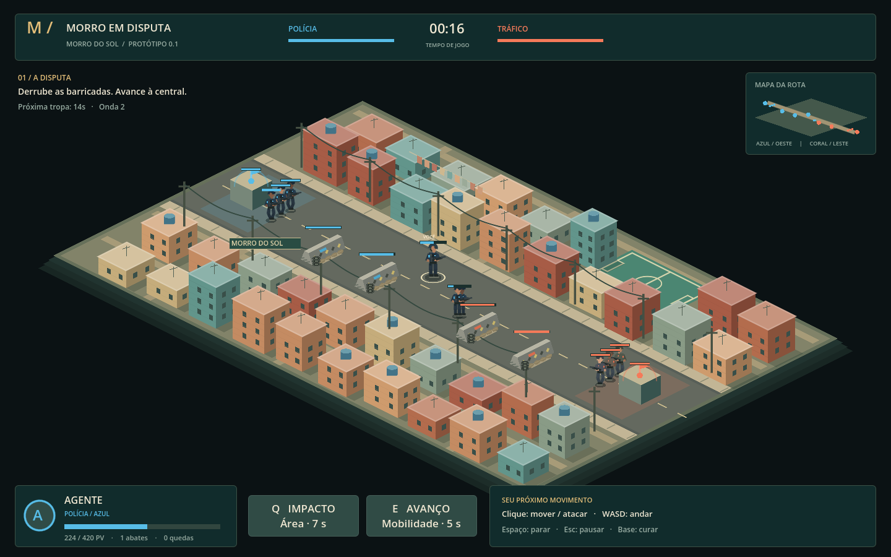

# Morro em Disputa

Base jogável de um **MOBA isométrico com apresentação 3D em Godot 4.6**, ambientado no Morro do Sol, uma favela brasileira fictícia. Dois lados disputam a mesma rota: **Polícia / Equipe Azul** e **Tráfico / Equipe Coral**. A partida usa a mesma simulação do protótipo e permite alternar o visual clássico com **F2**.



## Rodar com Docker

```bash
docker compose up --build -d
```

O jogo fica disponível por HTTP na **porta 8080** do host. O Dockerfile testa e exporta o projeto com Godot 4.6.3 e serve os arquivos com Nginx; não é necessário instalar Godot na hospedagem. Configure o domínio do seu provedor para encaminhar à porta 8080.

Consulte [execução e publicação com Docker](docs/DOCKER.md) para configuração de porta, logs, build sem Compose e uso em redes com proxy.

## Ambiente 3D independente

Abra [`scenes/demo_3d.tscn`](scenes/demo_3d.tscn) no Godot e pressione **F6** para explorar o Morro do Sol em 3D. Use WASD para mover a câmera, Q/E ou o botão direito para girar, a roda para zoom e Home para restaurar a vista. O mapa editável está em [`scenes/world/district_3d.tscn`](scenes/world/district_3d.tscn).

O **F5** abre a partida com o novo visual 3D; **F2** alterna para a representação 2D sem reiniciar. Após atualizar a imagem Docker, a demonstração é servida em **`/3d/`**, enquanto a partida permanece em **`/`**. Veja [apresentação visual](docs/VISUAL_PRESENTATION.md) e [estrutura e controles da demonstração](docs/ENVIRONMENT_3D.md).

## Abrir e jogar

1. Instale o **Godot 4.6.x Standard**, com GDScript. A versão usada na validação foi **4.6.3**; não é necessário .NET.
2. Importe o arquivo [`project.godot`](project.godot) no gerenciador de projetos.
3. Pressione **F5** e escolha uma facção.
4. Acompanhe suas tropas, destrua as **duas barricadas inimigas** e depois a **central rival**. A central permanece protegida enquanto houver uma barricada de sua equipe.

No terminal, com `godot` no PATH:

```bash
godot --editor --path .
# Ou execute diretamente:
godot --path .
```

## Controles

| Comando | Ação |
| --- | --- |
| Clique esquerdo ou direito no chão | Mover pelo corredor jogável |
| Clique em um inimigo | Aproximar e atacar automaticamente |
| Shift + clique no chão ou minimapa | Avançar até o ponto, parando para atacar inimigos ao alcance |
| WASD | Movimento nas direções da tela |
| Q / botão Impacto | Dano em área e lentidão de 35% por 1,5 s; recarga de 7 s |
| E / botão Avanço | Avançar na última direção apontada no mapa; recarga de 5 s |
| B / botão Recuar | Caminhar até sua central para recuperar vida |
| Clique no minimapa | Ordenar movimento até o ponto da rota |
| Espaço | Manter posição e atacar ao alcance, sem perseguir |
| Esc / botão de pausa | Pausar / continuar e consultar controles |
| F2 | Alternar visual 3D / 2D durante a mesma partida |

Um personagem parado ataca automaticamente rivais ao alcance. Ficar perto da sua central recupera vida. Após uma derrota, o personagem retorna à base em **8 segundos**. A partida termina quando uma central é destruída; a tela final permite escolher uma facção e recomeçar.

Avance com os minions: as defesas priorizam tropas ao escolher um alvo, mas passam a mirar no herói que atacar outro herói sob sua proteção. A linha de mira sinaliza o disparo por **0,45 s**; sair do alcance nesse intervalo cancela o tiro. O bot recua à própria central com pouca vida e volta depois de se recuperar. Veja as [regras de combate](docs/GAME_DESIGN.md).

## O que já funciona

- Seleção das duas facções, com cores e personagens identificáveis.
- Mapa isométrico procedural: casas, lajes, caixas-d'água, antenas, varais, postes, fiação e quadra.
- Uma rota livre de obstáculos, duas barricadas e uma central por equipe.
- Herói jogável, herói adversário com IA simples e ondas de três tropas por lado a cada 14 s.
- Ordens de mover, avançar atacando, perseguir um alvo e manter posição.
- Ataques automáticos, lentidão, prioridade e retaliação das defesas, recuo do bot, cura, retorno, vitória e reinício.
- HUD responsiva em português com minimapa clicável, vida das centrais, barricadas restantes, próxima onda, alvo, alerta de vida baixa e recargas numéricas.
- Partida com modelos 3D sincronizados com o combate, 43 casas, fachadas texturizadas, sombras de fim de tarde, fiação, fundo urbano desfocado, fumaça de dano e ruínas das defesas destruídas.

A [documentação da HUD](docs/HUD.md) explica os indicadores, as ações e os controles da interface 3D.

## Assets com Tripo

A integração com a **Tripo API v3** está preparada para gerar duas casas, barricada, caixa-d'água, heróis e minions. Os modelos locais substituem os visuais procedurais conforme forem disponibilizados; o jogo não usa a chave da API em tempo de execução.

```bash
python3 tools/tripo_assets.py plan
# Com TRIPO_API_KEY configurada e acesso à API:
python3 tools/tripo_assets.py generate --asset house_brick
```

Nenhum GLB real foi gerado nesta etapa: a chave `triploapi` e a rede estão disponíveis, mas a Tripo recusou a criação com **code 2010 — créditos insuficientes**. Veja [configuração, prompts, geração e retomada](docs/TRIPO_ASSETS.md).

Esta versão é **local e para um jogador**, com arte procedural estilizada. As facções compartilham os mesmos atributos e habilidades. Ainda não há multiplayer, loja, itens, progressão de nível, áudio, múltiplas rotas, navegação entre casas ou arte final. A apresentação usa geometria e materiais 3D; movimento e alcance continuam no plano lógico da simulação existente.

## Organização

```text
assets/                 Ícone e futuros sprites, áudio e fontes
scenes/main.tscn         Cena principal: mundo, unidades, efeitos e interface
resources/factions/     Dados editáveis de cada facção (.tres)
scripts/
  core/iso.gd           Projeção, seleção e limites de movimento
  data/                 Recursos de facção e regras de balanceamento
  actors/unit_actor.gd  Heróis, tropas, barricadas e centrais
  match/                Estado, comandos e simulação da partida
  world/                Cenário procedural e efeitos de combate
  ui/                   Interface, seleção, pausa e resultado
tests/                  Testes de simulação e entrada pela interface
tools/                  Execução na nuvem, preparação e captura visual
docs/                   Design, arquitetura e próximos passos
```

Para mudar vida, dano, velocidade e recargas, edite [`match_rules.gd`](scripts/data/match_rules.gd). Para mudar nomes e cores, abra os recursos em `resources/factions/` pelo Inspector. As regras de combate não dependem do desenho dos personagens.

## Validação

Não há pacotes externos nem serviços obrigatórios. Na nuvem, o helper mantém os diretórios graváveis do Godot fora do checkout:

```bash
bash tools/setup.sh
```

Esse comando importa o projeto e executa **187 verificações**: 29 de simulação, 8 de entrada, 34 do ambiente 3D, 23 da HUD, 39 das mecânicas, 18 da apresentação, 12 da integração Tripo no Godot e 24 testes Python offline do cliente da API. Os testes Tripo usam fixtures locais e não consomem créditos.

Para executar separadamente:

```bash
bash tools/godot.sh --headless --script tests/match_smoke.gd
bash tools/godot.sh --headless --script tests/input_smoke.gd
bash tools/godot.sh --headless --script tests/district_3d_smoke.gd
bash tools/godot.sh --headless --script tests/hud_smoke.gd
bash tools/godot.sh --headless --script tests/mechanics_smoke.gd
bash tools/godot.sh --headless --script tests/presentation_smoke.gd
bash tools/godot.sh --headless --script tests/tripo_assets_smoke.gd
python3 -m unittest discover -s tests -p 'test_tripo_assets.py'
```

O teste de partida completa acelera o tempo e dirige um herói que avança e usa Q; ele verifica se esse comportamento consegue vencer em até 20 minutos simulados. Não substitui playtesting de equilíbrio ou teste de multiplayer.

A suíte de mecânicas também joga uma partida com cada facção usando os comandos públicos de avanço com ataque, Impacto e recuo para cura. As duas devem conseguir vencer em até 30 minutos simulados.

Capturas opcionais, em uma máquina com display:

```bash
bash tools/godot.sh --audio-driver Dummy --script tools/capture_preview.gd -- /tmp/morro-preview
```

Mais detalhes: [design e evolução](docs/GAME_DESIGN.md), [arquitetura](docs/ARCHITECTURE.md) e [ambiente na nuvem](docs/CLOUD_ENVIRONMENT.md).

## Versão para navegador

```bash
bash tools/export_web.sh
```

A versão HTML5 foi executada e validada no Chromium. O pacote `builds/morro-em-disputa-web.zip` contém os arquivos para hospedagem estática; a pasta `builds/web/` contém o site pronto. Ainda é uma partida local contra bot.

A build HTML5 já foi enviada à branch remota `gh-pages`. Para liberar o site, abra **Settings → Pages**, escolha **Deploy from a branch → gh-pages → /(root)** e salve. A resposta do site público ainda não pôde ser validada neste ambiente.

O repositório também inclui um [workflow opcional de GitHub Pages](.github/workflows/publish-web.yml), executado apenas manualmente. Para outra hospedagem, envie os arquivos de `builds/web/` conforme as [instruções de publicação](docs/WEB.md).
