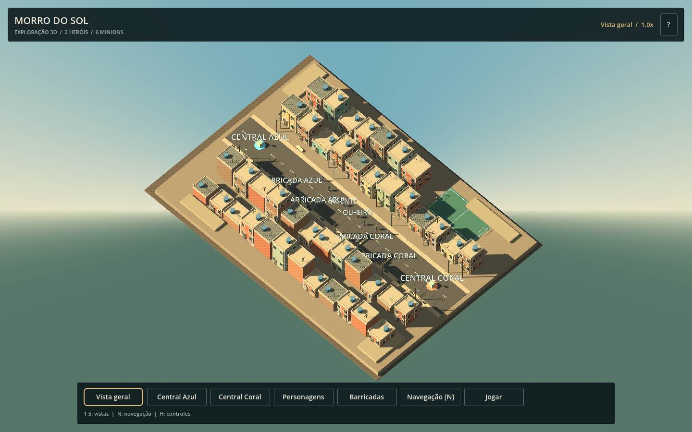
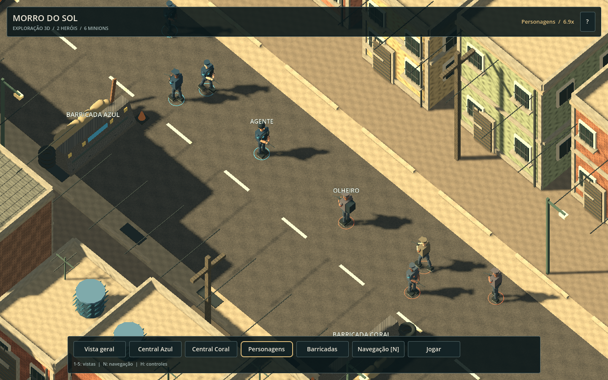
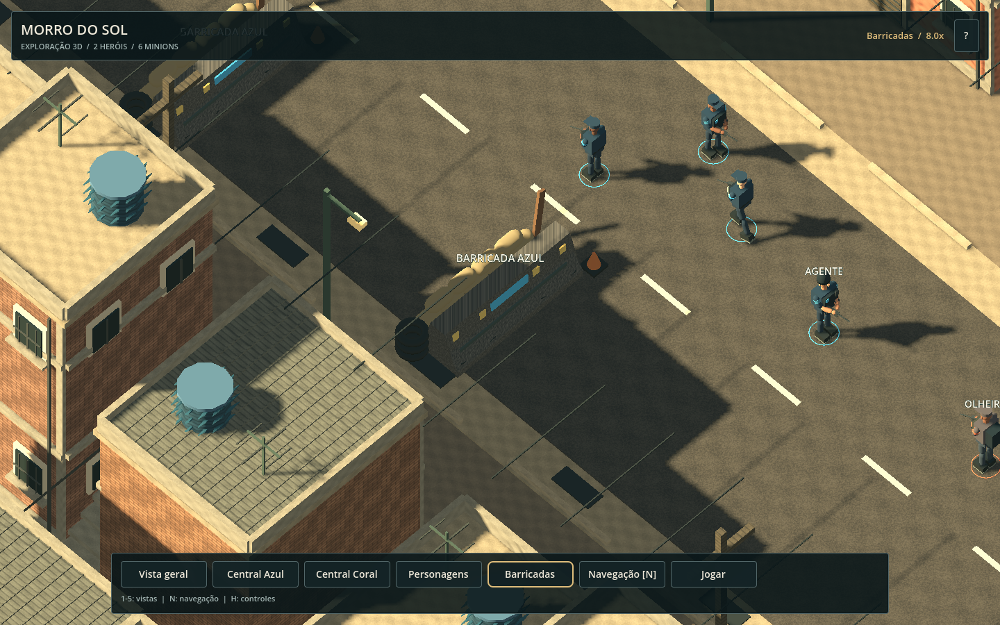

# Ambiente 3D — Morro do Sol

O distrito usa **Godot 4.6.3** e o renderer **Compatibility**. Ele é compartilhado pela demonstração de exploração e pela [apresentação 3D da partida](VISUAL_PRESENTATION.md). O desenho 2D original continua acessível com F2 na partida.



## Abrir a demonstração

No editor, abra `scenes/demo_3d.tscn` e pressione **F6**. Para editar o mapa, abra `scenes/world/district_3d.tscn`. A cena do distrito é um módulo de ambiente; a câmera e a interface de exploração pertencem à demonstração.

No terminal:

```bash
bash tools/godot.sh res://scenes/demo_3d.tscn
```

O **F5** inicia a partida com a apresentação 3D. O botão **Jogar** da demonstração também leva à cena principal.

## Exploração

| Comando | Ação |
| --- | --- |
| WASD | Deslocar a câmera nas direções da tela |
| Q / E | Girar a vista |
| Arrastar com o botão direito | Ajustar rotação e inclinação |
| Roda do mouse | Aproximar ou afastar |
| Arrastar com o botão do meio | Deslocar a vista |
| Home / 1 / Vista geral | Restaurar o enquadramento inicial |
| 2 / Central Azul | Enquadrar a central azul |
| 3 / Central Coral | Enquadrar a central coral |
| 4 / Personagens | Aproximar dos heróis e das tropas |
| 5 / Barricadas | Inspecionar a defesa de concreto e seus objetos |
| N / Navegação | Mostrar o corredor navegável em azul translúcido |
| H / ? | Abrir ou fechar a ajuda da câmera |

A barra inferior reorganiza os botões em linhas conforme a largura da janela. O cabeçalho mostra o enquadramento selecionado e o zoom atual; mover a câmera manualmente muda o estado para **Vista livre**. Veja também [HUD e interface](HUD.md).

## Organização da cena

```text
District3D
├── Terrain               terreno, colisão, rua e calçadas
├── Buildings             22 casas editáveis + 21 módulos adicionais determinísticos
├── Decoration            quadra, postes e bancos
├── Lighting              DirectionalLight3D e WorldEnvironment
├── Navigation
│   ├── Lane              NavigationRegion3D e malha inicial da rota
│   └── Preview           visualização opcional da área navegável
├── PointsOfInterest      centrais, barricadas, nascimentos e centro
└── Units                 dois heróis e seis minions de demonstração
```

`1 unidade Godot = 1 metro`. O terreno mede **70 × 50 m**. A rua tem **8 m** de largura e uma faixa navegável de **60 × 4 m**, deslocada para `Z = -1,7 m` para manter distância das barricadas. O chão transitável está perto de `Y = 0`; pequenas espessuras dos pisos e a malha de navegação usam deslocamentos de centímetros para evitar sobreposição visual.

O oeste é identificado por azul e o leste por coral. As posições são `Marker3D` com nomes explícitos. Na partida, esses marcadores visuais são ocultados e substituídos pelos modelos das unidades reais da simulação.

## Módulos editáveis

- `scenes/world/modules/house_block_3d.tscn`: corpo, laje, janelas, porta, caixa-d'água e antena. No Inspector, ajuste `footprint`, `building_height`, `facade_material` e `water_tank`. Um script `@tool` atualiza dimensões e colisão no editor e na execução.
- `scenes/world/modules/landmark_3d.tscn`: marcador visual de central, com texto, cor e altura ajustáveis.
- `scenes/world/modules/barricade_3d.tscn`: barreira de concreto com perfil inclinado, textura procedural de desgaste, faixas refletivas, pneus e sacos de areia. Possui colisão estática; substitui os antigos marcadores em forma de coluna.
- `scenes/actors/character_visual_3d.tscn`: modelo humano articulado com cabeça, mãos, braços, pernas, botas, roupas e equipamento. As propriedades `team`, `hero` e `variation` selecionam uniforme, acessórios e variações de pele.
- Materiais de fachada são compartilhados pelos módulos. Os modelos são primitivas nativas do Godot; não há dependências de modelos ou texturas externos.

A Polícia usa uniforme azul escuro, colete e capacete ou boné. O Tráfico usa roupas em tons urbanos, boné e acessórios de identificação coral. Os heróis têm equipamentos adicionais. Os minions mantêm proporções adultas, com equipamentos mais simples. Os modelos reutilizam materiais e malhas e possuem movimentos de respiração, quadril, braços, joelhos e caminhada.

As seis tropas da demonstração percorrem trechos próprios dentro da faixa livre da rota. A patrulha demonstra o modelo e sua animação; as decisões de combate e o dano pertencem à partida principal.





As casas possuem colisão simplificada. A navegação inicial cobre somente a rota central livre; a quadra e as vielas laterais são cenário nesta etapa. A malha é criada ao carregar a região e sincronizada de forma assíncrona pelo servidor de navegação. Alterar o traçado ou colocar obstáculos na rota exigirá revisar essa malha.

## Navegador e Docker

Para gerar a demonstração web separadamente:

```bash
bash tools/export_web.sh Web3D
```

Saídas: `builds/web-3d/` e `builds/morro-em-disputa-3d-web.zip`. O preset `Web3D` ativa a feature `demo_3d`, cuja sobrescrita de `run/main_scene` inicia a demonstração. O preset `Web` inicia a partida com apresentação 3D e alternância para o desenho 2D.

O Dockerfile exporta as duas versões. Após compilar e fazer deploy da imagem atualizada, o caminho **`/`** abre a partida e **`/3d/`** abre a demonstração. Ambos usam a porta interna **8080** e os mesmos requisitos de HTTPS e WebGL 2. A imagem mantém dois pacotes web independentes, incluindo seus runtimes, para permitir abrir cada versão diretamente.

## Validação e limites

```bash
bash tools/setup.sh
# Apenas o ambiente 3D:
bash tools/godot.sh --headless --script tests/district_3d_smoke.gd
```

O setup executa **37 verificações de simulação e entrada**, **39 de mecânicas**, **34 do ambiente 3D**, **23 da HUD** e **18 da apresentação**, totalizando **151**. A suíte 3D carrega a demonstração real, verifica grupos, módulos, dimensões, colisões, marcadores, câmera e uma rota entre os nascimentos consultada pelo `NavigationServer3D`. A suíte da HUD também verifica os botões, atalhos e o layout responsivo da demonstração.

A demonstração também foi exportada e executada no Chromium com WebGL 2, com inspeção visual e comandos de câmera. Os testes headless verificam estrutura e comportamento; a validação no navegador verifica a renderização.

Esta demonstração é um ambiente de exploração com arte estilizada; sua patrulha não executa uma segunda simulação de partida. Os mesmos modelos são usados pelas unidades reais na cena principal. A apresentação da partida conserva o movimento e os alcances do plano lógico; combate baseado em colisões físicas 3D e navegação autônoma entre casas ficam para etapas futuras.
