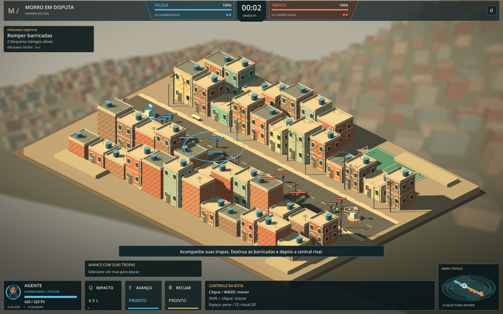
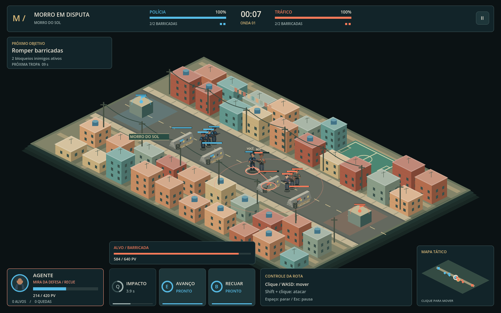

# Morro em Disputa — documento inicial

## Visão

Um MOBA isométrico em uma favela brasileira fictícia, com leitura clara do combate, partidas centradas em objetivos e identidade visual brasileira. O nome e o cenário são provisórios. A primeira entrega é uma fatia jogável local para testar a rota antes de ampliar o escopo.

O Morro do Sol combina tijolo aparente, reboco colorido, lajes, caixas-d'água azuis, fiação, becos e uma quadra. A partida usa uma apresentação 3D com modelos articulados, fachadas texturizadas, sombras de fim de tarde e paisagem urbana desfocada. F2 permite usar o desenho vetorial original. A direção visual permanece estilizada; ambas as representações usam a mesma simulação de combate.

## Equipes

| Lado | Identificação | Herói inicial | Base |
| --- | --- | --- | --- |
| Polícia | Azul, oeste | Agente | Central Azul |
| Tráfico | Coral, leste | Olheiro | Central Coral |

Não são reproduzidas organizações reais. A escolha é visual nesta versão: vida, dano, alcance, velocidade e habilidades são iguais. A IA rival escolhe alvos, avança e recua para se curar; ainda não usa habilidades.

## Ciclo da partida atual

1. Escolher uma equipe e aparecer perto de sua central.
2. Acompanhar a primeira onda, que sai após 2 segundos. Novas ondas saem a cada 14 segundos.
3. Disputar espaço e eliminar tropas com ataques e Impacto.
4. Aproveitar a presença das tropas para pressionar as barricadas.
5. Destruir as duas barricadas rivais para liberar o dano à central.
6. Destruir a central e reiniciar pela tela de resultado.

O corredor jogável é contínuo e sem colisores intermediários. As casas são cenário. Recuar até a própria base recupera vida; morrer impõe 8 segundos de espera. Não há perda de recursos, compras ou experiência nesta fase.

## Habilidades

- **Impacto (Q):** 70 de dano em um raio lógico de 155 unidades e redução de velocidade de 35% por 1,5 s; recarga de 7 s. Atinge heróis e tropas inimigas, sem danificar estruturas ou afetar aliados. Os atingidos recebem um anel e o indicador **LENTO**.
- **Avanço (E):** deslocamento de até 125 unidades na última direção apontada no mapa; recarga de 5 s. Respeita os limites da rota e mantém a distância mesmo sob lentidão. Uma tentativa totalmente bloqueada pelo limite não consome recarga.
- **Ataque básico:** automático contra o alvo da ordem atual, respeitando alcance e intervalo entre ataques.

## Ordens e controle do herói

| Ordem | Comando | Comportamento |
| --- | --- | --- |
| Mover | Clique no chão, minimapa ou WASD | Prioriza deslocamento e interrompe a perseguição |
| Avançar atacando | Shift + clique no chão ou minimapa | Para para atacar inimigos ao alcance e retoma o destino original após eliminá-los ou perdê-los de alcance |
| Atacar alvo | Clique em um inimigo | Persegue o alvo selecionado; ao eliminá-lo, mantém a posição atual |
| Manter posição | Espaço | Ataca inimigos ao alcance, sem persegui-los quando saem dele |
| Recuar | B / Recuar | Caminha até a própria central, onde a cura por proximidade se aplica |

Novas ordens substituem a anterior. Avanço encerra a perseguição e mantém a posição de chegada. Pausa, derrota e fim de partida bloqueiam os comandos de jogo.

## Defesas e pressão de rota

Barricadas e centrais escolhem primeiro um minion inimigo ao alcance. Mantêm esse alvo até ele morrer ou sair do alcance, mesmo que outro oponente se aproxime mais. Isso permite usar a onda para pressionar a rota.

Se um herói causar dano a outro herói e ambos estiverem no alcance de uma defesa da vítima, essa defesa prioriza o agressor por **3 s** após o último dano. Impacto também provoca essa retaliação. Sair do alcance encerra a prioridade; depois ela volta a escolher minions. Atacar somente uma estrutura ou um minion não aciona essa proteção de heróis.

Cada disparo de defesa tem **0,45 s de preparação**, sinalizado por uma linha de mira. Quando o jogador é o alvo, aparecem o alcance da defesa, uma marca no chão e o aviso **MIRA DA DEFESA / RECUE** na HUD. Sair do alcance ou eliminar a defesa antes do disparo cancela o dano. O ataque não é um projétil físico após o disparo.

## Comportamento das unidades

Tropas e heróis automáticos mantêm o alvo atual enquanto ele está vivo e dentro da distância de detecção. O bot com **28% de vida ou menos** interrompe o combate e caminha até a própria central. Usa a mesma cura por proximidade do jogador e retorna à rota ao recuperar **78% de vida**. O indicador **RECUANDO** comunica essa decisão. Ele continua sujeito a ataques e pode morrer durante o recuo.

O protótipo não usa dano aleatório. A configuração inicial está concentrada em `MatchRules`.

## Próximas entregas sugeridas

### 1. Fechar a experiência de uma rota

- Playtesting dos tempos de avanço, cura, recarga e duração das partidas.
- Trocar as silhuetas por sprites com oito direções e animações de ataque e derrota.
- Inserir áudio, feedback de seleção, indicação de alcance e alvos mais legíveis.
- Extrair heróis para cenas próprias e separar habilidades em recursos reutilizáveis.
- Mapear controles em InputMap e criar opções de remapeamento e acessibilidade.

Critério de conclusão: as duas equipes conseguem jogar, vencer, perder e recomeçar uma partida completa com boa leitura dos objetivos.

### 2. Aprofundar o MOBA

- Heróis com funções diferentes: resistência, dano e suporte.
- Experiência, níveis, economia, itens e loja na base.
- Novas rotas, becos transitáveis, navegação e colisão com o cenário.
- Objetivos neutros e recursos de visão; IA que usa habilidades e coordena ataques com as tropas.
- Migrar casas e trechos do mapa para cenas editáveis ou TileMapLayer.

Critério de conclusão: escolhas de composição, itens e movimentação produzem estratégias distintas.

### 3. Multiplayer

- Definir primeiro o tamanho das equipes e os limites de conexão esperados.
- Servidor autoritativo para movimento, dano, recargas e resultados.
- Comandos de jogador com identificação e validação pelo servidor.
- Replicação de estado, interpolação, entrada na partida e reconexão.
- Só então salas, autenticação, matchmaking e persistência de conta.

O código atual roda em um único processo. A separação entre coordenadas lógicas e desenho ajuda essa evolução, mas não implementa rede nem garante determinismo entre máquinas.
