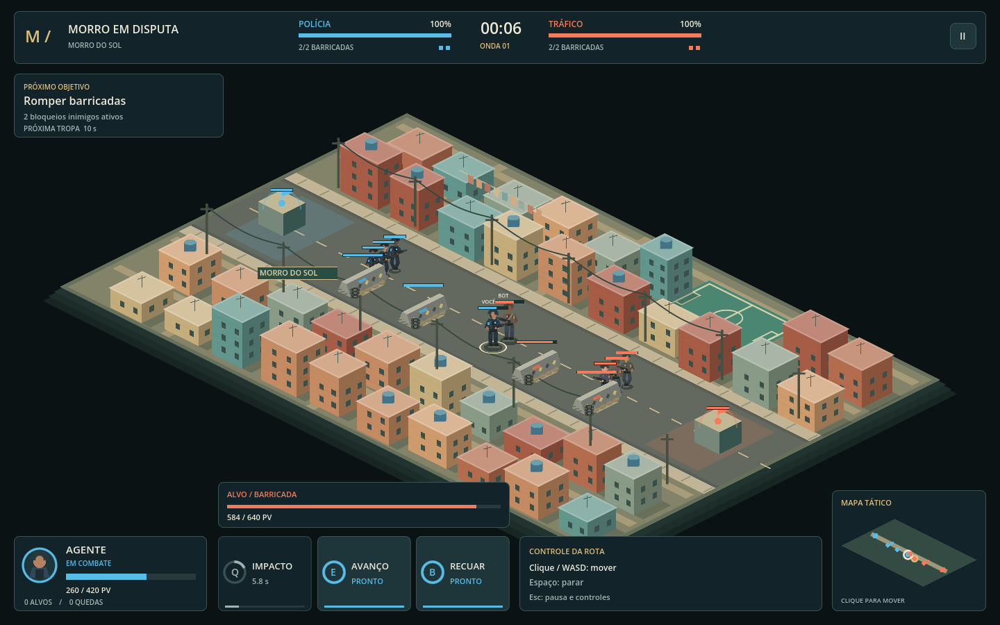
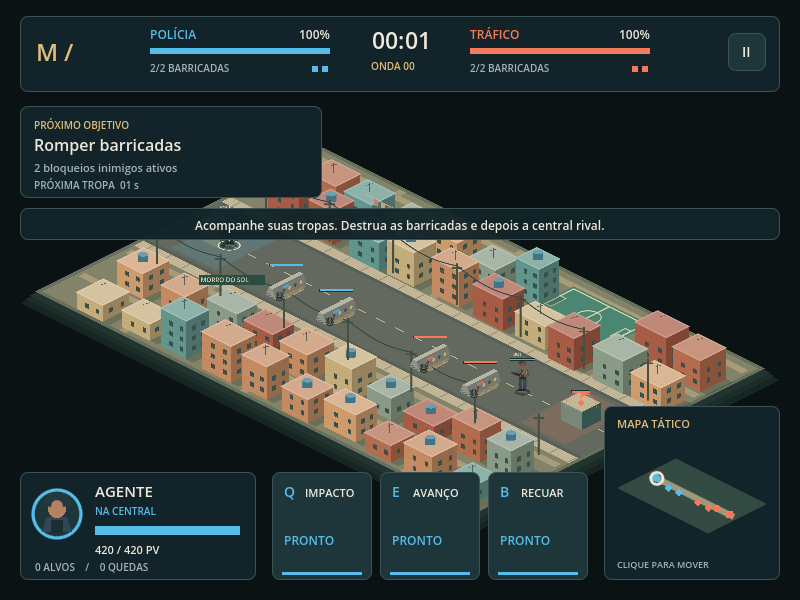
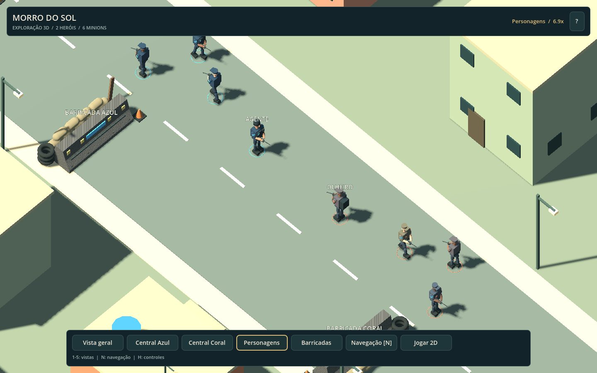

# HUD e interface

A interface usa painéis escuros, texto claro, destaques dourados e as cores azul e coral das equipes. O layout foi verificado em **1440×900**, **800×600** e **480×800**. Em janelas estreitas, as habilidades ficam acima do cartão do herói e o minimapa ocupa o canto superior direito. O jogo continua exigindo teclado e mouse.



## Partida 2D

| Indicador | Origem e comportamento |
| --- | --- |
| Cabeçalho | Tempo da partida, onda atual, vida percentual das centrais e barricadas vivas de cada equipe |
| Próximo objetivo | Barricadas inimigas restantes; muda para a central quando ela fica vulnerável |
| Próxima tropa | Contagem até a próxima onda da simulação |
| Herói | Nome, retrato da equipe, vida atual/máxima e estado de movimento, combate, cura ou retorno |
| Vida baixa | Texto e borda destacados quando o herói vivo fica abaixo de 30% de vida |
| Alvo | Tipo e vida do inimigo selecionado; sem alvo, apresenta uma dica de avanço |
| Habilidades | Atalho, disponibilidade e segundos reais de recarga |
| Retorno | Tempo restante até o herói reaparecer na central |

O contador **Alvos** registra as eliminações creditadas ao jogador, incluindo minions e estruturas; **Quedas** conta as derrotas do jogador. Não representa apenas eliminações de heróis.

**Q / Impacto** causa dano em área. **E / Avanço** usa a última direção apontada no mundo, preservando a mira ao clicar no botão da HUD. **B / Recuar** ordena que o herói caminhe até sua central; a cura continua dependendo da proximidade da base. Os botões das habilidades ficam desabilitados durante sua recarga, a pausa e a espera pelo retorno.

O **minimapa** mostra heróis, tropas, barricadas e centrais nas posições da partida. O círculo branco identifica o jogador; o traço dourado indica sua ordem de movimento ou ataque. Clique no mapa para ordenar movimento até o ponto correspondente da rota. Os limites da rota continuam sendo aplicados pelo controlador.



O botão **II** ou **Esc** abre a pausa e os controles. **Continuar / Esc** retoma a mesma partida. Cliques nos painéis e na pausa são consumidos pela interface.

## Demonstração 3D



A barra inferior permite alternar entre vista geral, centrais, personagens e barricadas. Os botões se distribuem em linhas conforme a janela; o cabeçalho indica a vista ativa e o zoom atual. Atalhos: **1–5** para enquadramentos, **N** para navegação e **H / ?** para a ajuda da câmera. **Jogar 2D** abre a partida original.

Essa interface acompanha o ambiente de exploração 3D. A vida, as habilidades e os objetivos de combate pertencem à partida 2D.

## Validar

```bash
bash tools/setup.sh
# Apenas os 23 testes de integração da HUD:
bash tools/godot.sh --headless --script tests/hud_smoke.gd
```

Os testes injetam eventos reais no viewport e consultam o estado da partida. A exportação Docker das duas cenas também foi inspecionada no Chromium nos três tamanhos de janela acima.
