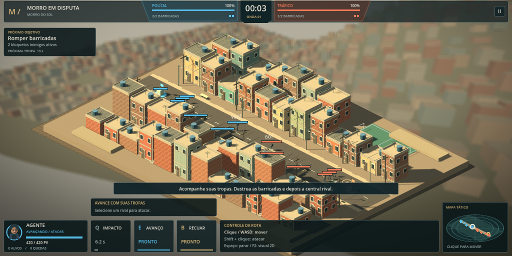

# Apresentação visual da partida

A cena principal abre uma apresentação 3D da mesma partida local. A composição segue a referência visual: bairro em forma de diorama, câmera isométrica, iluminação de fim de tarde, fundo urbano desfocado e HUD compacta com painéis escuros, placar angular e minimapa com anéis.



## Usar

Abra `project.godot` e pressione **F5**, ou faça build e deploy do Dockerfile e abra o caminho **`/`**. Os controles de combate continuam os mesmos. **F2** alterna entre a apresentação 3D e o desenho 2D original sem alterar vida, recargas, posições ou progresso. **Esc** pausa ambas as apresentações.

A demo em `scenes/demo_3d.tscn` e **`/3d/`** continua disponível para inspeção livre do cenário. Seu botão **Jogar** abre a partida.

## Construção

- As 22 casas editáveis recebem 21 módulos adicionais determinísticos. Fachadas usam tijolo ou reboco com desgaste, textura normal, pilares, grades, portas, lajes, parapeitos, antenas e nervuras nas caixas-d'água.
- `MorroMaterials` compartilha texturas de 128×128 com mipmaps e materiais por acabamento. `MorroMeshBatch` reúne pequenos detalhes por material. A instância do distrito usada na partida também agrupa a geometria estática para reduzir chamadas de desenho no WebGL; a cena de inspeção mantém seus módulos editáveis.
- A paisagem de fundo é outro mundo 3D, desenhado uma vez em 640×360 e desfocado por um shader de tela. Esse desfoque não afeta o mapa, as unidades ou a mira.
- Os personagens exibidos correspondem às unidades reais da simulação. Caminhada, posição, facção, vida, morte e retorno acompanham o controlador; os modelos da demo não são usados como uma segunda simulação.
- Fumaça depende do dano real às estruturas. Destruir uma defesa remove seu modelo ativo e deixa entulho. Pausar congela a animação e as partículas.

`1 unidade lógica = 0,05 m` na apresentação. A câmera ortográfica a 30° reproduz a projeção de `Iso.project()`, incluindo enquadramento e deslocamento da tela. Isso mantém cliques, direção do WASD, minimapa e indicadores de alcance alinhados.

O renderer continua sendo **Compatibility**, com MSAA 2× na apresentação principal. A cena usa geometria e materiais procedurais, sem modelos, fotografias ou serviços externos. O resultado é uma aproximação estilizada da referência; não é uma reprodução fotográfica.

## Validação

```bash
bash tools/setup.sh
bash tools/godot.sh --headless --script tests/presentation_smoke.gd
```

Os 18 testes da apresentação verificam alinhamento em 1440×900, 1024×512, 800×600 e 480×800, orientação da malha dos morros, seleção da barricada pelo centro renderizado, movimento, ondas, dano, fumaça, entulho, pausa, reinício, retorno e alternância de visual. A inspeção de materiais, luz e composição exige a versão gráfica ou a exportação web.
